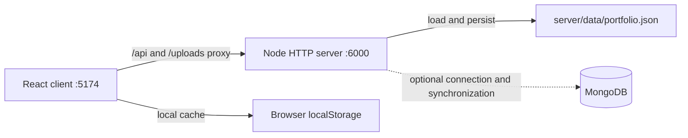

# Architecture

## Repository layout

```text
client/
  public/                 Static public assets
  src/app/                App composition, routes, and providers
  src/components/         Shared layout, UI, particles, and project components
  src/pages/              Home, About, Journey, Skills, Projects, Certificates, Contact, Admin
  src/services/api.js     API requests, uploads, and backend state sync
  src/styles/             Global, component, and page styles
  src/utils/              Crypto, validation, SEO, audio, and content helpers
server/
  src/config/             Environment and database configuration
  src/controllers/        Request handlers
  src/middleware/         Auth, rate limiting, and response security headers
  src/models/             Mongo models and seed data
  src/repositories/       JSON state store and Mongo persistence
  src/routes/             Public, auth, and admin route dispatch
  src/services/           Crypto, media, analytics, AI helper, and LeetCode services
  scripts/                Seed, setup, cleanup, and maintenance scripts
  tests/                  Backend verification suite
docs/                     Project documentation
scripts/                  Root-level development and maintenance utilities
```

## Frontend

The client is React 18 with Vite and React Router. `client/src/app/router.jsx` defines the public pages (`/`, `/about`, `/journey`, `/achievements`, `/skills`, `/projects`, `/certificates`, `/contact`, `/connect`, `/hire`) and admin routes (`/login`, `/admin/*`). `ThemeProvider` loads cached local state and requests `/api/public/bootstrap`; it also coordinates UI state and synchronization. `AuthProvider` currently implements a separate client-side admin login/session flow. `client/src/services/api.js` handles credentialed API calls, CSRF headers, media uploads, and state sync.

The Vite dev server uses port `5174` and proxies `/api` and `/uploads` to port `6000`. Production builds are split into vendor and admin chunks by `client/vite.config.js`.

## Backend

The server is a Node.js `http` server with explicit route dispatch; it does not use Express middleware despite Express being listed in `server/package.json`. `server/src/index.js` constructs the app, attempts MongoDB connection, and listens on the configured port. `server/src/app.js` applies security headers, serves `/uploads/*`, and dispatches API routes.

Route handlers are grouped in `server/src/routes/` and implemented in `server/src/controllers/`. Admin routes cover profile, projects, certificates, skills, media, messages, settings, analytics, AI case study generation, and portfolio sync. The public routes include portfolio data, contact, LeetCode stats, telemetry, an AI assistant endpoint, a sandbox API namespace, and sitemap output.

## Persistence

`PortfolioDataStore` in `server/src/repositories/portfolioRepository.js` loads `server/data/portfolio.json`, creating it from `server/src/models/seedData.js` when absent. Writes use a temporary file followed by rename. MongoDB is optional at startup: `server/src/config/db.js` attempts to connect and synchronizes store data with Mongo collections when connected. The store starts in JSON mode and changes mode after a successful Mongo connection. Mongo sync errors are logged as warnings.

The browser also caches portfolio state in local storage. The client has direct Cloudinary unsigned-upload support when cloud name and upload preset are configured; otherwise it falls back to base64 data URLs. This is distinct from the server-side media endpoint, which validates uploaded image bytes.

## Data flow



## Authentication boundary

The backend authenticates admin requests with a signed, HTTP-only `argon_session` cookie or a valid signed bearer token. Mutating requests also require an `X-CSRF-Token` matching the server-issued token in the signed session. The React `AuthProvider` uses `/api/auth/login` and keeps the CSRF token in memory/session storage; it does not generate an admin session itself. Password changes go through `/api/auth/password` and require the current password, valid session, and CSRF token. See [VERIFICATION.md](./VERIFICATION.md) for reviewed fixes and verification coverage.
