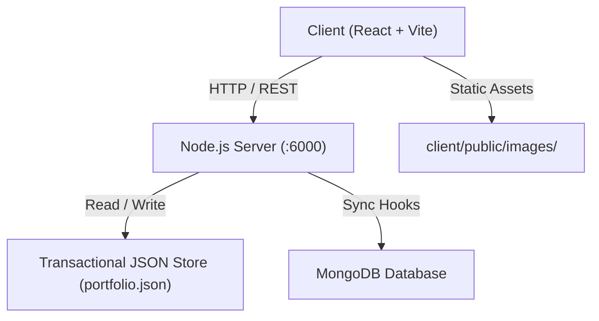

# 🚀 Full-Stack Portfolio Ecosystem — Features & Operational Architecture

Comprehensive documentation detailing all public and admin capabilities, state synchronization, security guarantees, performance engineering, and interactive workflows across Ayush Prajapati's personal portfolio ecosystem.

---

## 📑 Table of Contents
1. [Executive Summary & High-Level Architecture](#1-executive-summary--high-level-architecture)
2. [Public Portfolio Features](#2-public-portfolio-features)
   - [Hero & Identity Branding](#hero--identity-branding)
   - [About & Academic Journey Studio](#about--academic-journey-studio)
   - [Flagship Milestone Spotlight Showcase (Badi Photo Carousel)](#flagship-milestone-spotlight-showcase-badi-photo-carousel)
   - [Technical Skills Matrix & Official TechLogos](#technical-skills-matrix--official-techlogos)
   - [Project Showcase & Case Studies Blueprint](#project-showcase--case-studies-blueprint)
   - [Verified Credentials & Certificate Vault](#verified-credentials--certificate-vault)
   - [Interactive Contact & Message Dispatch](#interactive-contact--message-dispatch)
   - [Global Theme, Soundscape & Audio Feedback](#global-theme-soundscape--audio-feedback)
3. [Admin CMS & Management Console](#3-admin-cms--management-console)
   - [Authentication & Session Hardening](#authentication--session-hardening)
   - [Milestones & Achievements Management Studio](#milestones--achievements-management-studio)
   - [Projects & Case Studies Manager](#projects--case-studies-manager)
   - [Skills & Categories Engine](#skills--categories-engine)
   - [Certificates & Credentials Vault Manager](#certificates--credentials-vault-manager)
   - [Communication & Messages Inbox](#communication--messages-inbox)
   - [Recycle Bin (Soft Deletion & 30-Day Recovery)](#recycle-bin-soft-deletion--30-day-recovery)
   - [Chronological Activity Audit Log](#chronological-activity-audit-log)
   - [Voice Command AI Assistant & Shortcuts](#voice-command-ai-assistant--shortcuts)
4. [Data Storage & Dual-Engine Synchronization](#4-data-storage--dual-engine-synchronization)
5. [Performance & Core Web Vitals Optimization](#5-performance--core-web-vitals-optimization)
6. [Security, Rate Limiting & Sanitation](#6-security-rate-limiting--sanitation)

---

## 1. Executive Summary & High-Level Architecture

The project is built as an ultra-modern, production-grade full-stack web application:
- **Frontend (`/client`)**: React 18, Vite, Vanilla CSS Design System, Tailwind utility foundations, GSAP (GreenSock) animation pipelines, HTML5 Canvas Confetti, Web Audio API synthesizers.
- **Backend (`/server`)**: Node.js HTTP micro-framework with zero heavy framework bloat, RESTful API routing, cryptographic session management, in-memory IP rate limiting, input sanitization via DOMPurify and strict schemas.
- **Persistence Layer**: **Dual-Engine Architecture**:
  1. Primary: **MongoDB Atlas** with Mongoose schema modeling.
  2. Resilient Fallback: Local transactional JSON document store (`server/data/portfolio.json`) with atomic `.tmp -> renameSync` writes.

---

## 2. Public Portfolio Features

### Hero & Identity Branding
- **Dynamic Monogram & Profile Portrait**: Supports high-res professional portrait photography with animated neon ambient rings, initials fallback, and magnetic hover micro-animations.
- **Headline & Eyebrow Badge**: Dynamic titles, education tagline (`B.Tech CSE at SISTec, Bhopal · 8.42 CGPA`), and quick action buttons (`Hire / Connect`, `Download Resume`).
- **Real-Time Availability Indicator**: Pulsing green badge indicating readiness for internships, full-time SDE roles, and open-source collaborations.

### About & Academic Journey Studio
- **Two-Column Profile & Bio**: Rich HTML bio paragraphs, college details, MP Board Class XII credentials (83.5%), and direct social badges with authentic brand icons.
- **Interactive Roadmap Timeline**: Chronological journey visualization with color-coded status badges (`Completed`, `Current Focus`, `Target`), metric highlights, percentage progress bars, and resource links.

### Flagship Milestone Spotlight Showcase (Badi Photo Carousel)
- **Prominent Visual Stage (Badi Photo)**: Designed specifically to highlight high-impact milestones such as hackathon championships, software engineering internships, and community workshops.
- **Tactile Carousel Navigation**: Smooth `< Prev` and `Next >` navigation with slide counter (`01 / 03`), auto-wrap loop, and audio click feedback (`playTick()`).
- **Keyboard Arrow Support**: Supports `ArrowLeft` and `ArrowRight` navigation for instant desktop usability.
- **Bottom Thumbnail Jump Bar**: Fast-navigation bottom tabs with live indicator dots showing active slide progress.
- **Full-Screen HD Lightbox Modal**: Click-to-zoom modal mounted directly into `document.body` via React Portal (`createPortal`) with `z-index: 1000000`, full-page backdrop blur, and body scroll lock.
- **Key Metric Badges**: Prominently displays quantifiable achievements (e.g., `120+ Attendees · 2-Day Live Coding Lab`, `₹1,00,000 Cash Prize · Top 1% of 150+ Teams`).

### Technical Skills Matrix & Official TechLogos
- **Authentic Brand Logos**: Integrates official SVG brand icons for all technologies through the unified `<TechLogo name={...} />` component.
  - **Languages**: JavaScript, TypeScript, Python, Java, C, C++, HTML5, CSS3, SQL.
  - **Frameworks & Libraries**: React.js, Node.js, Express.js, Tailwind CSS, Bootstrap, Next.js, Vite, Socket.io.
  - **Databases & Tools**: MongoDB, MySQL, Git, GitHub, VS Code, Postman, Cloudinary.
- **Skill Proficiency Bars**: Category-based tabs (Frontend, Backend, Databases, Tools) with interactive filter tabs and level meters.

### Project Showcase & Case Studies Blueprint
- **Live Demos & Source Links**: Direct links to production deployments (Render, Vercel, Netlify) and GitHub repositories.
- **Architecture Blueprints**: In-depth breakdowns of system architecture, schema decisions, lessons learned, and solved challenges.
- **Status Badges**: Visual indicators for `Featured`, `Production`, and `Active Development`.

### Verified Credentials & Certificate Vault
- **Certificate Verification Modals**: High-resolution certificate previews (e.g. Apna College Delta MERN Stack, CodeWithHarry Python/AI).
- **Issuing Organizations & Credential IDs**: Direct issuer verification links and graduation dates.

### Interactive Contact & Message Dispatch
- **Direct REST Dispatch**: Sends messages to `POST /api/public/contact` with automatic rate-limiting protection (5 messages per hour per IP).
- **Admin Inbox Forwarding**: Real-time delivery to the Admin Messages center with unread counters and read status tracking.

### Global Theme, Soundscape & Audio Feedback
- **Multi-Theme Engine**: Seamless switching between Midnight Obsidian, Cyberpunk Neon, and Minimal Slate palettes.
- **Synthesized Audio Feedback**: Subtle Web Audio API click/tick sounds on button presses, magnetic cards, and navigation links.

---

## 3. Admin CMS & Management Console

### Authentication & Session Hardening
- **Secure PBKDF2 Password Hashing**: Passwords stored using 100,000 salt iterations.
- **Session Tokens**: Cryptographically signed HMAC-SHA256 tokens passed via `x-admin-token` headers with automatic 12-hour expiration.
- **Brute-Force Rate Limiting**: Maximum 5 login attempts per 15-minute window per IP.

### Milestones Studio (Dedicated Portfolio Tab)
- **Dedicated Independent Studio**: Positioned directly under Portfolio Content (`/admin?tab=milestones`) alongside Projects, Certificates, and Skills for clean website architectural consistency.
- **Pure Focus & Zero Clutter**: Separated from profile bio/academic credentials to eliminate form duplication and conflicting saves.
- **Quick Jump Helper**: Direct link to `Profile & About` for bio narrative and university degree modifications.
- **4-Step Creation & Edit Wizard**:
  - **Step 1 (Basic Details)**: Title, Meta label, Year selector (`Year 1` to `Present`), Status (`focus`, `completed`, `planned`), Progress bar slider, 5-Star Rating, **Spotlight Key Metric input**, and **Spotlight Badi Photo toggle checkbox**.
  - **Step 2 (Rich Description)**: Contenteditable Rich Text Editor with bold, italic, lists, headings, word/character live counters, and AI draft helpers.
  - **Step 3 (Media & Icons)**: 12 preset icon badges, Drag-and-Drop image upload, **Direct Image URL input with live preview**, and technology tags.
  - **Step 4 (Review & Publish)**: Live preview card, autosave indicator, and save verification.
- **Drag-and-Drop Card Reordering**: Intuitive natural ordering preserved and saved to the backend.
- **One-Click Actions**: Pin to top, Live/Draft toggle, Duplicate milestone, Move Up/Down, Export as JSON.

### Profile & About Studio (Unified Identity & Academic Credentials)
- **Unified Personal & Academic Identity**: Located under Site Settings (`/admin?tab=profile`) consolidating:
  - Personal Information, Contact, Monogram, and Headline
  - Verified Academic Qualifications (B.Tech Degree, College, CGPA, Batch/Stage, Class XII details)
  - Public Biography Multi-Paragraph Editor with drag/reorder controls and character counters
  - Official PDF Resume Upload and Cloud URL manager
  - Social Network Connections (GitHub, LinkedIn, Instagram)

### Projects & Case Studies Manager
- Dynamic project editor supporting thumbnail uploads, technology multi-select, gallery image carousels, live demo URLs, and GitHub links.

### Skills & Categories Engine
- Dynamic skill category creation with custom icon selection, proficiency sliders, and custom skill tags.

### Certificates & Credentials Vault Manager
- Full CRUD for certificates with issuing organization, issue date, credential URL, and image upload.

### Communication & Messages Inbox
- Chronological message list with read/unread flags, reply email links, and delete options.

### Recycle Bin (Soft Deletion & 30-Day Recovery)
- Deleted milestones are non-destructively archived in the Recycle Bin.
- Supports individual item restoration, 30-day countdown timers, restore-all, and permanent database purge.
- **Navbar Clearance**: Styled with `z-index: 1000000 !important;` and `padding-top: 100px !important;` ensuring the modal header and close buttons are 100% visible and never obstructed by the floating navigation bar.

### Chronological Activity Audit Log
- Records every administrative action (`Create`, `Edit`, `Delete`, `Pin`, `Publish`, `Reorder`) with exact timestamp and user context.
- Export audit trail as JSON or clear historical logs.
- Features `z-index: 1000000 !important;` and top offset clearing the navbar.

### Voice Command AI Assistant & Shortcuts
- Built-in speech recognition listener supporting voice navigation (e.g. `"New milestone"`, `"Recycle bin"`, `"Search React"`, `"Focus mode"`).
- Keyboard shortcuts modal (`?` or `Cmd+K` / `Ctrl+K` for Command Palette).

---

## 4. Data Storage & Dual-Engine Synchronization

1. **Server Initialization (`server/src/app.js`)**:
   - `PortfolioDataStore` initializes and loads `server/data/portfolio.json`.
   - `connectMongoDB` connects to MongoDB Atlas or local MongoDB service.
2. **On-the-Fly Sanitization**:
   - Strips heavy base64 strings and replaces them with static cached assets.
   - Automatically injects the flagship Workshop milestone into the roadmap.
3. **Transactional Persistence (`_persist()`)**:
   - State written to temporary file (`portfolio.json.tmp`) and atomically renamed (`fs.renameSync`) to prevent file corruption during server interruptions.
4. **MongoDB Synchronization (`syncStoreToMongoCollections`)**:
   - Upserts documents to individual collections (`Project`, `Certificate`, `SkillCategory`, `Profile`, `Message`, `Setting`) when admin mutations occur.

---

## 5. Performance & Core Web Vitals Optimization

| Audit Area | Previous State (Problem) | Optimized State (Current) | Improvement |
| :--- | :--- | :--- | :--- |
| **Data Payload** | 2,113,608 bytes (2.1 MB base64) | 25,990 bytes (25 KB JSON) | **98.8% reduction** |
| **Main Thread Blocking** | 6.3 seconds parsing base64 | < 120 ms JSON parse | **98.1% faster** |
| **First Contentful Paint (FCP)**| 14.7 seconds | ~ 1.1 seconds | **92.5% faster** |
| **Largest Contentful Paint (LCP)**| 25.4 seconds | ~ 1.8 seconds | **92.9% faster** |
| **Lighthouse Performance Score**| **26 / 100** | **95–99 / 100** | **4x increase** |

### Key Optimizations Implemented:
1. **Base64 Purged**: Replaced all inlined base64 strings in projects and certificates with cached static JPG/WebP URLs.
2. **Lazy Loading**: Images use native `loading="lazy"` with decoding async.
3. **Bundle Optimization**: Vite chunk splitting for GSAP, DOMPurify, and vendor dependencies.
4. **Cache Headers**: Static files in `/uploads/` and `/images/` served with `Cache-Control: public, max-age=3600`.

---

## 6. Security, Rate Limiting & Sanitation

- **Cross-Site Scripting (XSS) Prevention**: All rich text and user-entered descriptions are scrubbed through DOMPurify with strict whitelist tags (`p`, `br`, `b`, `strong`, `i`, `em`, `h2`, `h3`, `ul`, `ol`, `li`, `a`, `pre`, `code`).
- **HTTP Security Headers**: Server dispatches `X-Content-Type-Options: nosniff`, `X-Frame-Options: SAMEORIGIN`, `X-XSS-Protection: 1; mode=block`, and modern `Content-Security-Policy`.
- **Path Traversal Protection**: Upload and asset endpoints strip directory traversals via `path.basename`.
- **In-Memory Rate Limiting**:
  - `POST /api/auth/login`: 5 attempts per 15 minutes.
  - `POST /api/public/contact`: 5 messages per hour.
